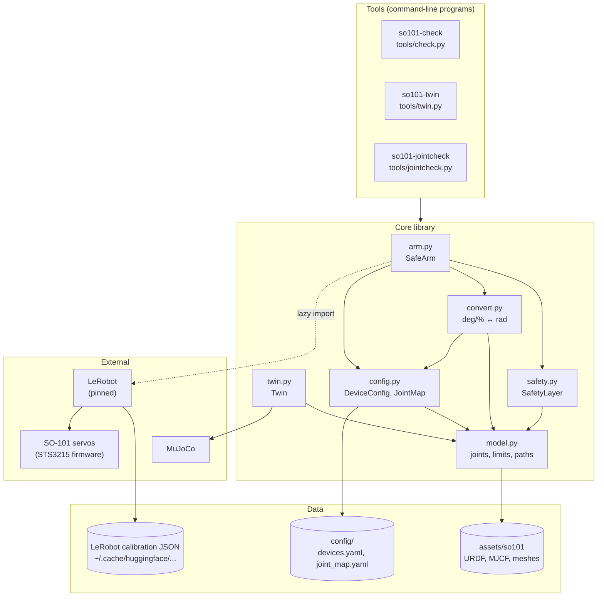
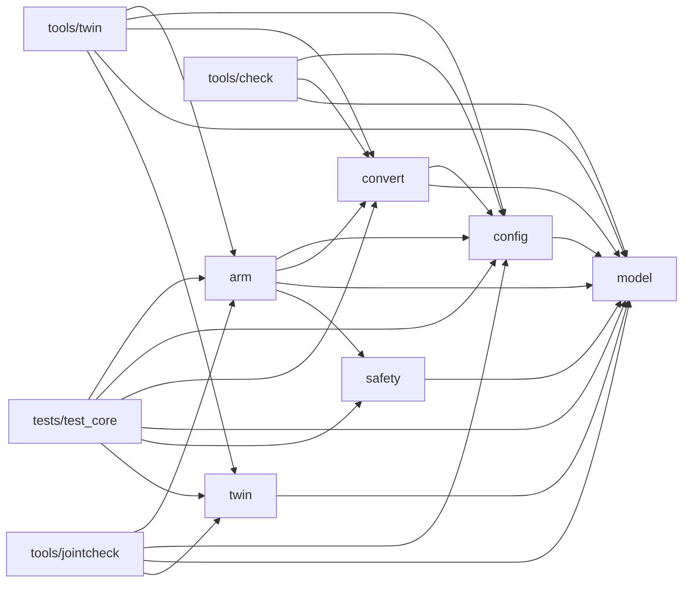
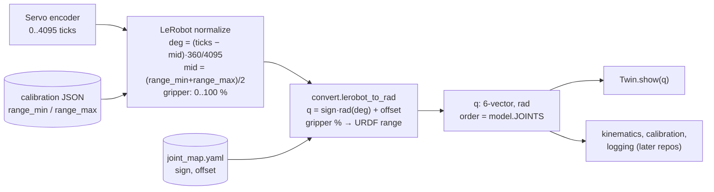
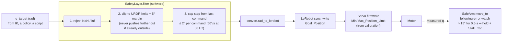
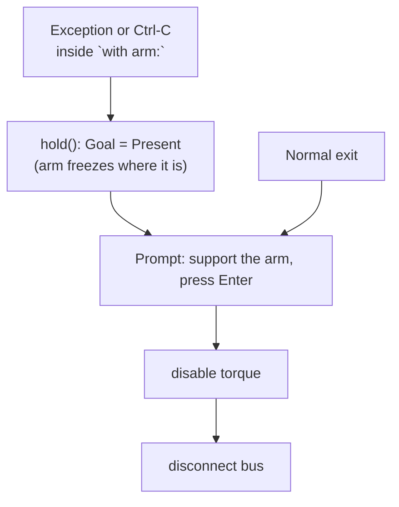

# so101-core design

Why this package looks the way it does, how its parts fit together, and which parts matter
most. State as of 2026-11-06, end of M0.

## 1. What it is for

`so101-core` is the shared layer under every repo in the SO-101 series:

- M1 `so101-kinematics`
- M2 `so101-calib`
- M3 `so101-policy`
- M4 `vla-isp-probe`
- M5 `so101-plan-vs-learn`

It answers four questions once, so the later repos never answer them differently:

1. **How do I talk to the arm safely?** (`arm`, `safety`)
2. **What units and angle conventions do joint values use?** (`convert`, `config.JointMap`)
3. **Which robot model and limits are true?** (`model`, vendored URDF/MJCF)
4. **How do I see what the arm is doing?** (`twin`)

It deliberately does **not** do kinematics (M1), calibration (M2) or learning (M3). It stays
small so that it can be trusted.

## 2. Design goals

| Goal | What it means in the code |
|---|---|
| **Safety first** | Every command to the real arm passes through one function (`SafetyLayer.filter`). There is no other path to `Goal_Position`. |
| **One place for units** | Radians and SI units everywhere inside. LeRobot's degrees and gripper % appear only in `convert.py`. |
| **Testable without hardware** | LeRobot is imported lazily, inside functions, never at module top level. `SafeArm` accepts an injected robot, so tests run against a fake servo bus. CI installs no LeRobot at all. |
| **Wrap, don't fork** | LeRobot is pinned to one commit and used as a driver. Where its behavior is unsafe for this use (see §6), the wrapper works around it rather than patching LeRobot. |
| **Facts, not assumptions** | Joint signs, offsets and the rest pose are *verified on the real arm* (`so101-jointcheck`) and stored with a date. |
| **Small** | About 500 lines of library code. Anything specific to one project lives in that project's repo. |

## 3. Architecture

### 3.1 Layers



### 3.2 Module dependencies (exact imports)



`model` is the root: it depends on nothing in the package. `arm` is the highest-level library
module. LeRobot is imported only inside `arm._build_robot`, `tools/check.main` and
`tools/twin.open_device`.

## 4. Data flow

### 4.1 Reading the arm



The "middle" that defines zero comes from the LeRobot calibration JSON: the range swept by hand
at calibration. The model's "new calibration" URDF/MJCF uses the same convention: zero is the
middle of each joint range. That is why the verified joint map is the identity.

### 4.2 Commanding the arm (three layers of protection)



| Layer | Protects against | Where |
|---|---|---|
| Limit clip with margin | Targets outside the joint range, such as an unconstrained IK solution | `safety.py` |
| Step cap | Large jumps between commands (the servo would run at full speed) | `safety.py` |
| Firmware position limits | Anything that gets past the software | Servo registers, written by LeRobot calibration |
| Following-error watch | Collisions, blocked joints, stalls (no force sensor; the lag *is* the sensor) | `arm.move_to` (15° for 0.5 s), `arm.follow` (5° for 0.3 s) |

None of these detects a collision *before* it happens. That needs a collision model (M1+).

## 5. Key sequences

### 5.1 `SafeArm.connect(torque=True)`

```mermaid
sequenceDiagram
    participant U as Caller
    participant A as SafeArm
    participant B as LeRobot bus
    participant S as Servos
    U->>A: connect(torque=True)
    A->>B: connect() (handshake: all 6 IDs answer?)
    A->>B: is_calibrated?
    alt calibration mismatch
        A-->>U: RuntimeError (never auto-calibrates)
    end
    A->>B: read Present_Position (raw)
    A->>B: write Goal_Position = Present (raw)
    Note over A,S: torque still off: no motion possible
    A->>B: robot.configure() (PID, protection, mode; ends with torque ON)
    A->>B: write Goal_Position = Present again
    A->>A: q_cmd = read()
    A-->>U: ready, holding position
```

### 5.2 `SafeArm.move_to(q_goal)`

```mermaid
stateDiagram-v2
    [*] --> Ramp
    Ramp --> Ramp: command q_cmd + step toward goal (≤ speed/hz)
    Ramp --> Stall: measured lags command > 15° for 0.5 s
    Ramp --> Timeout: ramp not finished after 15 s
    Ramp --> Settle: q_cmd == goal
    Settle --> Done: no joint moved > 0.3° within 0.2 s
    Settle --> Done: 2 s passed (still creeping; residual returned)
    Settle --> Stall: lag > 15° for 0.5 s
    Stall --> [*]: hold() + StallError
    Timeout --> [*]: hold() + TimeoutError
    Done --> [*]: return measured q
```



"Done" means **settled**, not "at the goal". A servo holding a load keeps a steady-state error.
The first version waited for |q − goal| < 2° on every joint, and a sagging elbow made every move
wait for the timeout. The residual is now returned for the caller to measure, never hidden.

### 5.3 Shutdown and Ctrl-C



The arm is never released without the user confirming they are supporting it: with torque off
it falls under gravity.

## 6. Design decisions and rejected alternatives

| Decision | Why | Rejected alternative |
|---|---|---|
| Own `connect()` sequence instead of `SOFollower.connect()` | LeRobot enables torque without syncing the goal, so a stale goal means a jump at power-up | Trusting the default and hoping the goal register is fresh |
| Write `Goal_Position` directly instead of `send_action()` | Our safety layer already limits steps. `send_action`'s `max_relative_target` would be a second, differently-tuned limiter | Two step limiters with different semantics |
| Never auto-calibrate | Calibration rewrites the motor registers and needs the user to move the arm by hand. It must be a deliberate act | LeRobot's `connect(calibrate=True)` default |
| Keep the LeRobot device object alive (not only its bus) | `Robot.__del__` disconnects the bus, and turns torque off, when the object is collected | Passing only `bus` around (caused the first `so101-twin` crash) |
| Radians inside, degrees only in `convert.py` | Pinocchio, MuJoCo and URDF all use radians; one boundary means one place for sign or unit bugs | Degrees everywhere (LeRobot's choice) |
| Joint map with sign + offset, verified on hardware | Units differ in how motors are mounted and calibrated; the check turns an assumption into a dated fact | Hard-coding identity |
| Safety margin 5°, step cap 2° per command | 5° keeps targets off the calibrated end stops; 2° at 30 Hz caps speed at 60°/s | Relying only on firmware limits |
| "Inward only" rule when starting outside the range | The rest pose is beyond the URDF limit (wrist_flex 95.7° > 95°). Clipping would force a jump on the first command | Plain `np.clip` |
| Stall detection from following error | The servos have no force sensor exposed here; a large lag between command and measurement is the cheapest collision signal | No detection (a blocked joint pushes until it overheats) |
| Settle-based completion | Steady-state error under gravity is real and should be measured, not waited out | Tolerance on absolute error (caused 15 s waits) |
| Commanded pose as baseline for relative moves | Re-commanding a measured (sagged) pose compounds the sag | Measured pose as baseline |
| Vendor URDF/MJCF and meshes (Apache-2.0, pinned commit) | Every repo sees the same model; no network at run time | Download at run time; a git submodule |
| `devices.yaml` git-ignored, example committed | It contains adapter serial numbers and is machine-specific | Committing paths |
| Fake servo bus in tests, no LeRobot in CI | Safety logic is tested on every push without hardware; CI stays fast | Testing only on the real arm |
| Background thread for the twin in `jointcheck` Phase A | `input()` blocks the main thread while the user moves the arm by hand | Polling input (more complex) |
| No ROS 2 | One arm, one process; ROS would add build and launch overhead without a benefit yet | ROS 2 control stack |

## 7. File by file

Importance: **★★★** load-bearing (a bug here can hurt hardware or corrupt every later result),
**★★** foundation, **★** supporting / tooling.

### Library (`src/so101_core/`)

| File | Lines | Importance | What it does | Uses | Used by |
|---|---:|:-:|---|---|---|
| `arm.py` | 214 | ★★★ | `SafeArm`: safe connect, read, `command`, `move_to` (ramp, settle, stall), `follow` (a trajectory at the safety rate with stall watch and a log of commanded vs measured; `dense=True` also reads between commands, for system identification), `hold`, `release` with confirmation, context manager. Also `Rate` (fixed-rate loop) and `StallError` | `config`, `convert`, `model`, `safety`; LeRobot (lazy) | `tools/jointcheck`, `tools/twin` (`Rate`), tests; all later repos |
| `safety.py` | 61 | ★★★ | `SafetyConfig` (margin, step, rate) and `SafetyLayer.filter`: NaN check, limit clip with inward-only rule, step cap | `model` | `arm`, tests |
| `convert.py` | 40 | ★★★ | The only unit boundary: `lerobot_to_rad`, `rad_to_lerobot` (arm joints and gripper) | `config`, `model` | `arm`, `tools/check`, `tools/twin`, tests |
| `config.py` | 88 | ★★ | `DeviceConfig` (ports, calibration IDs, camera paths) and `JointMap` (sign, offset, rest pose, verified date; load/save YAML); `config_dir()` lookup | `model` | `arm`, `convert`, all tools, tests |
| `model.py` | 31 | ★★ | Joint names and order (`JOINTS`), asset paths, `urdf_limits()` | vendored assets | everything |
| `twin.py` | 42 | ★★ | `Twin`: loads the MJCF scene, sets joint positions, optional passive viewer | `model`; MuJoCo | `tools/twin`, `tools/jointcheck`, tests; M1/M2 visualization |
| `__init__.py` | 12 | ★ | Package docstring with the conventions; re-exports joint names | `model` | importers |
| `assets/so101/` | data | ★★ | Vendored URDF, MJCF, scene and 13 meshes; `SOURCE.md` records origin and license | — | `model`, `twin` |

### Tools (`src/so101_core/tools/`, installed as commands)

| File | Command | Importance | Moves the arm? | What it does |
|---|---|:-:|:-:|---|
| `check.py` | `so101-check` | ★ | **Never** (read-only, torque untouched) | Device paths, calibration match, a table of ticks, degrees, radians and limits, plus torque, temperature and voltage |
| `twin.py` | `so101-twin` | ★ | No (torque off) | Live MuJoCo twin from the follower (by hand), the leader, or a sim sweep |
| `jointcheck.py` | `so101-jointcheck` | ★★ | Phase B only, after confirmation | Phase A: sign check by hand plus recording the rest pose. Phase B: +5° per joint, zero-pose comparison, residuals and timings. Writes `joint_map.yaml` and a dated log |

### Tests, config, project files

| File | Importance | What it does |
|---|:-:|---|
| `tests/test_core.py` | ★★ | 17 hardware-free tests. Model/MJCF agreement; zero pose is upright; conversion round trip; safety clip, step cap, inward-only and NaN rules; `SafeArm` against a fake servo bus: reaching goals within the step cap, stall detection naming the right joint, hold and release on exception, prompt return under gravity sag (regression); `follow`: tracking and the clipped / step-capped counts, stall detection, no false stall under sag, refusal of a path that starts far from the command |
| `config/devices.example.yaml` | ★ | Format of the machine-specific, git-ignored `devices.yaml` |
| `config/joint_map.yaml` | ★★ | Verified mapping and rest pose for *this* arm; read by everything that talks to it |
| `config/jointcheck_*.yaml` | ★ | Dated logs of each joint check (evidence) |
| `pyproject.toml`, `uv.lock`, `.python-version` | ★★ | Python 3.12, dependencies, LeRobot pin in the `hw` extra, command entry points |
| `.github/workflows/ci.yml` | ★ | ruff + pytest on every push, without LeRobot |
| `README.md`, `DECISIONS.md`, `docs/DESIGN.md` | ★ | Plan and findings; decision log; this document |

### If you read only three files

1. **`safety.py`**: the rules every command obeys (60 lines).
2. **`arm.py`**: how the arm is connected, moved, stopped and released.
3. **`convert.py`**: the single place where a unit or sign error could hide.

## 8. How later repos use it

```python
import numpy as np
from so101_core.arm import SafeArm
from so101_core.config import DeviceConfig
from so101_core.twin import Twin

twin = Twin().open_viewer()
with SafeArm(DeviceConfig.load()).connect(torque=True) as arm:
    q0 = arm.read()  # rad, ordered as so101_core.JOINTS
    target = q0 + np.deg2rad([10, 0, 0, 0, 0, 0])
    q = arm.move_to(target, on_tick=lambda q, q_cmd: twin.show(q))
    print("residual [deg]:", np.rad2deg(q - target))
    arm.move_to(arm.jm.rest)  # park; release asks for confirmation on exit
```

## 9. Known limits and open items

- **No collision model.** The safety layer limits *where* and *how fast*, not *what is in the way*.
  Stall detection reacts after contact.
- **The step cap is per command, not per second.** Speed depends on the loop rate. `move_to`
  enforces its own `speed_rad_s`; code that calls `command()` must keep to `rate_hz`.
- **The gripper uses a linear % → rad map** onto the URDF range. That is good enough for display
  and not checked against the real jaw opening.
- **The rest pose sits inside the margin**, so `move_to(rest)` stops up to 5° short of it. The arm
  settles the rest of the way when torque is released.
- **Elbow residual 2.6° at the zero pose.** Gravity sag is the hypothesis; it is measured
  properly in M1/M2 (system identification).
